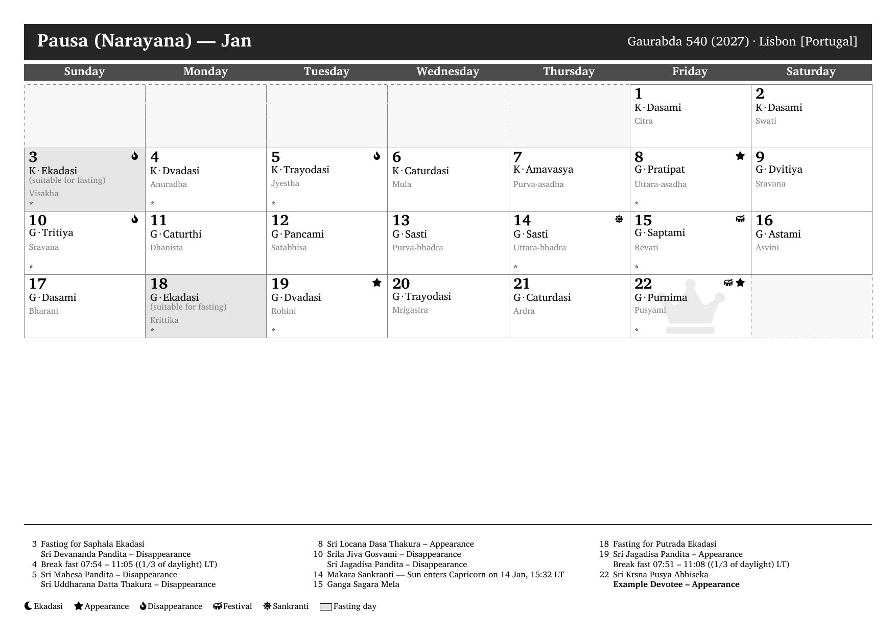
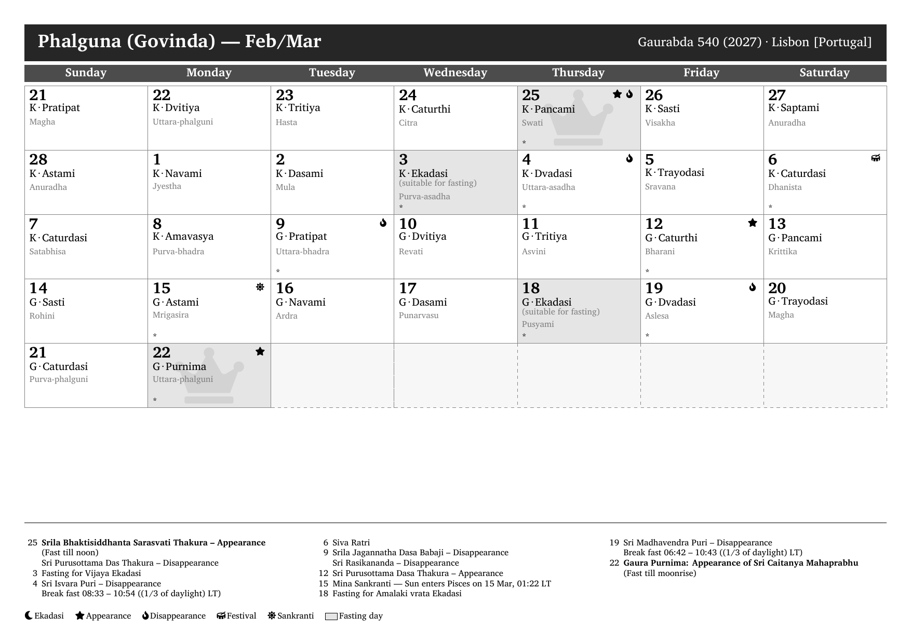

# Vedic Calendar

[](https://go.dev)
[](LICENSE)
[](https://www.luatex.org)

A Go + LuaLaTeX pipeline that turns GCal-exported Vedic calendar text into a
printable A4 landscape PDF, one page per lunar month. Drop a plaintext
calendar export in `data/`, run `make`, collect the PDF — festivals,
Ekadasi fasting days, appearances/disappearances, and sankrantis are laid out
on a Sunday-start grid with footnotes.

## 30-second example

Each input is a GCal-exported plaintext calendar (`data/*.txt`):

```
                       Pausa (Narayana) Masa, Gaurabda 540      GCal 11, Build 5

                      Lisbon [Portugal] (38N43 9W08, +0:00)

 DATE            TITHI                         PAKSA NAKSATRA       FAST
--------------------------------------------------------------------------------
 1 Jan 2027 Fr   Dasami                            K Citra
 2 Jan 2027 Sa   Dasami                            K Swati
 3 Jan 2027 Su   Ekadasi (suitable for fasting)    K Visakha         *
                 Fasting for Saphala Ekadasi
```

```sh
make check                                            # verify go + lualatex are installed
make FILE="data/Lisbon [Portugal]-2027.txt"           # text → JSON → LaTeX → PDF
# → output/Lisbon_Portugal_2027/calendar-Lisbon_Portugal_2027.pdf (13 pages)
```

## Sample output

| Pausa (Narayana) — Jan | Magha (Madhava) — Jan/Feb | Phalguna (Govinda) — Feb/Mar |
|---|---|---|
|  |  |  |

## Prerequisites

- Go 1.25+ (`go`) — builds the `parser`, `renderer`, and `merger` binaries
- LuaLaTeX (`lualatex`, TeX Live) — compiles the generated `.tex` into the PDF
  (TikZ grids, `multicol` footnotes, `fontspec` font loading)
- `Charis SIL` font (`fonts-sil-charis`) — the document `\setmainfont`; covers
  the transliteration diacritics (ā, ī, ṭh, ṅ, ñ, etc.)
- `fontawesome5` LaTeX package (TeX Live: `texlive-fonts-extra`) — grid icons
  (`\faMoon` Ekadasi, `\faStar` appearance, `\faFire` disappearance,
  `\faDrum` festival, `\faSun` sankranti, `\faCrown` highlight watermark)

```sh
sudo apt install texlive-luatex texlive-latex-extra texlive-fonts-extra fonts-sil-charis
```

## Commands

```sh
make                                       # build PDF from the most recently modified data/*.txt
make FILE="data/Lisbon [Portugal]-2027.txt"  # build PDF from a specific input file
make parse FILE="..."                      # text → JSON only (output/<name>/calendar.json)
make render FILE="..."                     # JSON → LaTeX only (output/<name>/calendar-<name>.tex)
make pdf FILE="..."                        # LaTeX → PDF only (output/<name>/calendar-<name>.pdf)
make clean                                 # rm -rf output/ and the parser/renderer/merger binaries
make check                                 # verify go + lualatex are installed
```

Tests: `go test ./...`

## Project layout

```
cmd/parser/main.go        # CLI: .txt + festivals.json → calendar.json
cmd/merger/main.go        # CLI: calendar.json + data/extra-*.json → merged.json
cmd/renderer/main.go      # CLI: merged.json + templates/ → calendar-<name>.tex
internal/models/          # shared structs (Calendar, VedicMonth, Day, Event) + JSON tags
internal/parser/          # plaintext classification (day entry, masa header, sankranti) → model
internal/merger/          # Vedic-date lookup (masa|paksa|tithi) injecting extra events
internal/renderer/        # model → week-grid cells, footnote numbering, template execution
templates/calendar.tex.tmpl  # LuaLaTeX template (TikZ grid, 3-column footnotes, legend)
data/*.txt                # GCal-exported sample inputs (one city per file)
data/festivals.json       # curated Gaudiya Vaisnava festivals (major/minor lists)
data/extra-*.json         # optional extra events, auto-globbed by the Makefile
scripts/check-deps.sh     # dependency check behind `make check`
docs/img/                 # screenshots rendered from real output (150 dpi)
output/                   # generated JSON/LaTeX/PDF per input (gitignored)
```

## Extra events (`data/extra-*.json`)

Any file matching `data/extra-*.json` is auto-globbed by the Makefile and merged
into the calendar before rendering. Each entry is matched to calendar days by
Vedic date (`masa` + `paksa` + `tithi`); the tithi's parenthetical qualifier is
ignored, so `"Ekadasi"` matches `"Ekadasi (suitable for fasting)"`. Unmatched
entries are reported on stderr and skipped.

```json
[
  {
    "masa": "Pausa",
    "paksa": "shukla",
    "tithi": "Purnima",
    "type": "appearance",
    "description": "Example Devotee -- Appearance",
    "highlight": true
  }
]
```

- `masa`: Vedic month name, e.g. `Pausa`, `Magha` (must match the input's masa headers)
- `paksa`: `shukla`/`krishna` (or `G`/`K`)
- `tithi`: base tithi name, e.g. `Purnima`, `Ekadasi`, `Dvadasi`
- `type`: `appearance`, `disappearance`, `festival`, `fast`, or `note`
- `description`: footnote/cell text, rendered as-is
- `highlight`: `true` bolds the footnote and adds a faint crown watermark to the cell

## Architecture

- **Parse** — `cmd/parser` reads the `.txt` line by line, classifies each line
  (day entry, continuation, masa header, sankranti), and emits `calendar.json`;
  `data/festivals.json` substring matching decides `festival` vs `note`, major
  festivals set `Highlight`.
- **Merge** — `cmd/merger` loads every `data/extra-*.json` and injects entries
  into matching days via a `masa|paksa|tithi` lookup, producing `merged.json`.
- **Render** — `cmd/renderer` converts days into Sunday-start week grids, assigns
  LaTeX icon commands (Unicode glyphs are missing from the main font), numbers
  footnotes per page, and executes `templates/calendar.tex.tmpl`.
- **Compile** — `lualatex` runs inside the per-input `output/<name>/` directory
  so `.aux`/`.log` files stay co-located with the `.tex`.
- **Contract** — JSON is the stable interface between stages; each stage is an
  independent binary runnable on its own (`make parse` / `make render` /
  `make pdf`).

## License

MIT — see [LICENSE](LICENSE).
